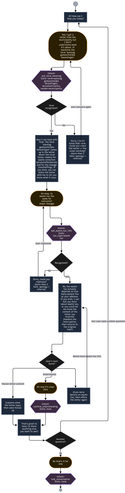

# SettleNL

SettleNL is a chatbot built with **Rasa CALM** for newcomers to the Nijmegen region, such as international students, early-career expats, and seasonal workers. It explains terms from official Dutch letters (for example, 'aanslag gemeentelijke belastingen') and answers questions about waste tax.

It was made by Group 5 for Human-centered and Inclusive Conversational Design (NWI-IMK016) and builds on [Jonan Richards' Rasa starter repository](https://github.com/jonan-richards/rasa-starter).

## Conversation flow diagram

The diagram shows the main conversation paths, including the bot prompts, example user utterances, intents, slots, and how the chatbot handles problems in the conversation.



## Files to explore

| File | What to look for |
| --- | --- |
| `data/flows.yml` | The `greet_user`, `ask_term_meaning`, `ask_waste_tax_info`, `share_letter_content`, `offer_more_help`, and `end_conversation` flows, including questions, branches, and action calls. |
| `domain.yml` | Slots, predefined questions and replies, and custom action names. |
| `actions/actions.py` | The glossary of official Dutch terms, term matching, letter explanation, and the counter for failed attempts. |
| `data/patterns.yml` | Handling small talk, unsupported informational questions, messages the chatbot does not understand, and saying goodbye when the user declines "anything else?". |
| `config.yml` | The CALM language-understanding and conversation policies. |
| `endpoints.yml` | The language-model and custom-action configuration. |
| `app.py` and `frontend/` | The Flask application and browser chat interface. |
| `run.sh` | A convenience script that starts Rasa and Flask together. |

For example, follow the happy path through the diagram and find the matching parts in these files: "Hi" → "I got a letter from the municipality but I don't understand what it's about. It mentions the term 'aanslag gemeentelijke belastingen'" → "Is waste tax the same for everyone?" → "Ah now it's clear thnx" → "No that's it for now". Then compare it with a term the chatbot does not know, such as 'huurtoeslag'.

# Getting Started
It's recommended to run this repository in GitHub Codespaces (in GitHub, press the green 'Code' button and then Codespaces). If you prefer to work in VS Code or another IDE, you need to manually run these commands:

```
pip install -U pip uv
uv venv
source .venv/bin/activate
uv pip install --extra-index-url https://europe-west3-python.pkg.dev/rasa-releases/rasa-pro-python/simple rasa-pro
uv pip install -r requirements.txt
```

Create a file called `.env` containing your license key:
```
RASA_LICENSE=<the Rasa license key you received when creating your developer account>
```

---

## Installation
**Train the Rasa model**

   ```bash
   rasa train
   ```

---

## Running the Application

You can run the application in two ways:

### Option 1: Using the convenience script

```bash
./run.sh
```

This script will:

- Start the Rasa server with proper CORS settings on port 5005
- Start the Flask server (frontend) on port 5000
- Press `Ctrl+C` to stop both servers

### Option 2: Starting servers manually

1. **Start the Flask server**

   ```bash
   python app.py
   ```

2. **Start the Rasa server (in a separate terminal)**

   ```bash
   rasa run --enable-api --cors "*"
   ```

   > **IMPORTANT**: The `--cors "*"` parameter is essential for the frontend to communicate with the Rasa API. Without it, you'll encounter CORS errors in your browser.

3. **Access the application**

   Open your browser and navigate to `<your-codespace-id-xxxxx>-5000.app.github.dev` if you are running the app in Github codespaces, or `http://localhost:5000` if you are running it locally.

---
